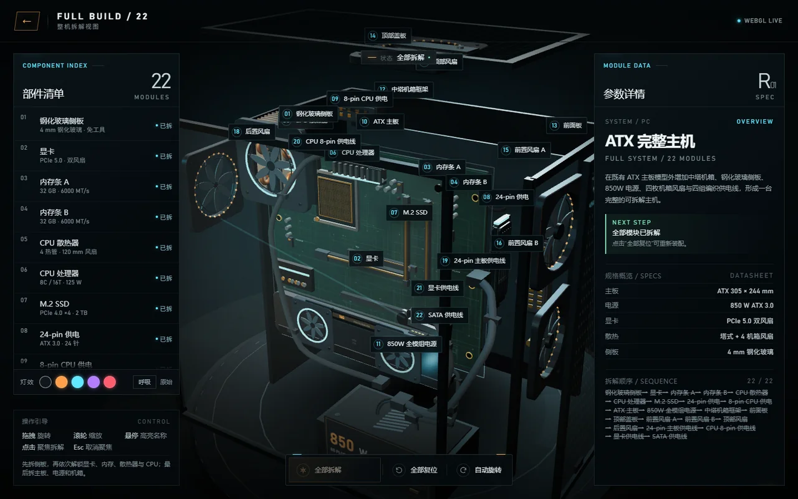
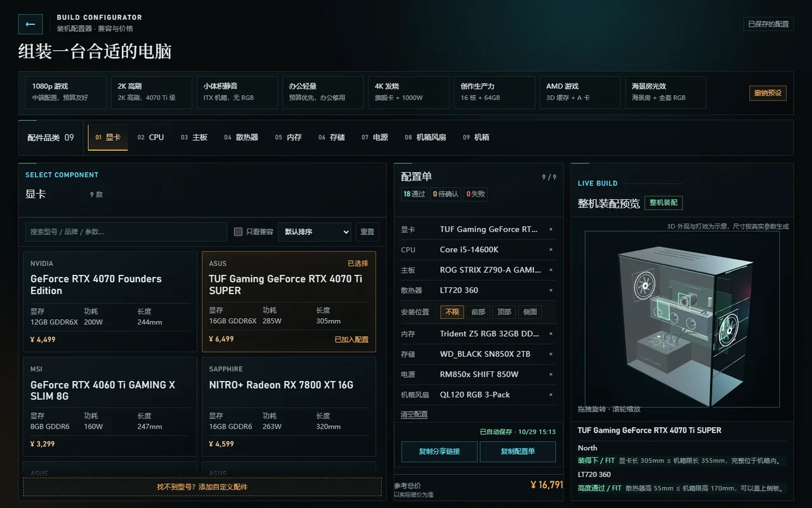

# 3D Build Lab · 拆装实验室

**在浏览器里把一台 PC 拆开，再配一台。**

纯静态站点：无构建步骤、无后端、无 CDN 依赖。Three.js r160 已打包在 `vendor/` 内，所有 3D 模型由代码程序化生成。



| 首页 | 装机配置器 |
|---|---|
|  |  |

三个页面：

| 页面 | 作用 |
|---|---|
| `index.html` | 产品目录：两台可拆样机 + 配置器入口 |
| `viewer.html` | 3D 拆解：`?id=motherboard`（9 模块）/ `?id=desktop`（22 模块） |
| `configurator.html` | 装机配置器：9 品类、18 项兼容检查、实时装配预览 |

## 功能

**拆解**

- 22 个独立可拆模块，带真实解锁链：侧板 → 显卡 → 内存 → 散热器 → CPU → 主板 → 电源 → 机箱
- 前置依赖未满足时锁定，并指名缺哪一步；右侧给出「建议下一步」
- 点击部件拆出 + 相机聚焦，再次点击归位；支持全部拆解 / 全部复位 / 自动旋转
- 拖拽旋转、滚轮缩放、悬停高亮；移动端清单变抽屉、详情变底部面板

**灯效**

- 整机页提供 5 档配色 + 呼吸开关，默认「原始」（保持原始配色）
- 用自发光材质 + 点光源实现，不依赖 Bloom 后处理

**装机配置器**

- 9 个品类共 65 个型号，选择时同步跑 18 项兼容检查
- 8 组用途预设，一键填入整套配置，可撤销
- 支持自定义配件（未填字段按「待确认」处理，不会默认通过）
- 自动保存到本机、最多 20 条历史、分享链接、配置对比、文字导出

**装配预览**

- 按配件参数程序化生成：机箱框架、主板、散热器、显卡、电源、内存、机箱风扇与示意走线
- 显卡超长 / 散热器超高 / 盖不上侧板时，用红色超出段与 `OVER` 标注；装得下显示绿色 `FIT`

## 本地运行

页面使用 ES module，必须经 HTTP 访问（直接双击 `file://` 会被浏览器拦截）。

**Windows**：双击根目录 [`start.bat`](./start.bat)。脚本会自动找 Python 3、探测 `8080`（占用则换 `8123`）、在最小化窗口起服务并打开浏览器。

**任意平台**：

```bash
python -m http.server 8080
```

然后访问：

- `http://127.0.0.1:8080/`
- `http://127.0.0.1:8080/viewer.html?id=motherboard`
- `http://127.0.0.1:8080/viewer.html?id=desktop`
- `http://127.0.0.1:8080/configurator.html`

## 项目结构

```text
index.html / viewer.html / configurator.html   三个页面
start.bat                       Windows 一键启动

css/home.css                    首页
css/viewer.css                  拆解页
css/configurator.css            配置器

js/engine.js                    场景、相机、控制器、拆解状态机、聚焦、画质自适应
js/ui.js                        部件清单、参数面板、引导、灯效、提示
js/loader.js                    读取产品注册表 → 建模型 → 挂 UI
js/configurator.js              选配、兼容检查、装配预览、保存分享

configs/index.js                产品注册表
configs/motherboard.js          ATX 主板配置（纯数据）
configs/desktop.js              ATX 整机配置，复用主板 parts

models/env.js                   全站共用的程序化 IBL 环境
models/motherboard.js           ATX 主板程序化模型
models/desktop.js               整机模型：复用主板 + 机箱/电源/风扇/线材
models/*-preview.js             配置器用的参数化小模型

data/components/*.json          9 个品类的配件数据（65 条）
data/presets.json               8 组用途预设

assets/                         产品卡片缩略图
docs/                           README 截图
vendor/three.bundle.js          Three.js r160 + addons（本地，不走 CDN）
LICENSE                         MIT
```

## 产品配置

`configs/*.js` 是纯数据模块。最小结构：

```js
export default {
  id: "product-id",
  name: "产品名",
  category: "分类",
  thumbnail: "assets/thumbnail.png",
  camera: { position: [x, y, z], target: [0, 0, 0], fov: 34, fovTablet: 38, fovNarrow: 42 },
  views: { exploded: { position: [x, y, z], target: [0, 0, 0] } },
  stage: { radius: 2.7, y: -1.65, accent: 0xffb15a, secondary: 0x5fe7ff },
  overview: { name, en, description, stats, specs },
  parts: [
    {
      id: "part-id",
      number: "01",
      name: "部件名",
      geometry: { type: "box", size: [1, 0.2, 0.6] },
      material: { color: 0x8899aa, metalness: 0.8, roughness: 0.3 },
      position: [0, 0, 0],
      explodeDir: [0, 1, 0],
      explodeDist: 1.2,
      deps: ["prerequisite-part-id"],
      focus: { theta: 0.6, phi: 1.2, radius: 4, target: [0, 0, 0] }
    }
  ]
};
```

复杂产品可以只写一个 `model` 字段指向模型工厂（`"MotherboardModel"` / `"DesktopModel"`），由工厂生成几何；没有 `model` 时按 `parts[].geometry` 直接生成。新增一个纯数据产品，只需要写 `configs/<id>.js` 并在 `configs/index.js` 注册。

### geometry 类型

| 类型 | 参数 |
|---|---|
| `box` | `size: [w, h, d]` |
| `cylinder` | `args: [radiusTop, radiusBottom, height, segments]` |
| `sphere` | `args: [radius, widthSegments, heightSegments]` |
| `plane` | `size: [w, h]` |
| `torus` | `args: [radius, tube, radialSegments, tubularSegments]` |
| `compound` | `children: [子 geometry]` |

段数统一限制在 32 以内。

## 装机配置器

### 18 项兼容检查

| # | 检查 | 判定 |
|---|---|---|
| 1 | CPU ↔ 主板插槽 | `cpu.compat.socket === motherboard.compat.socket` |
| 2 | 散热器 ↔ CPU 平台 | `cooler.compat.socket` 包含 CPU 插槽 |
| 3 | 主板板型 ↔ 机箱 | `case.compat.supportedFormFactors` 包含主板板型 |
| 4 | 显卡长度 ↔ 机箱限长 | `gpu.length ≤ case.maxGpuLength` |
| 5 | 显卡厚度 ↔ 机箱槽位 | `gpu.thickness ≤ case.maxGpuThickness` |
| 6 | 散热器高度 ↔ 机箱限高 | `cooler.height ≤ case.maxCoolerHeight` |
| 7 | 冷排规格 ↔ 机箱 | 冷排尺寸在 `case.supportedRadiatorSizes` 内 |
| 8 | 冷排位置 ↔ 安装位 | 按 `radiatorPosition` 查 `case.radiatorPositions` |
| 9 | 冷排厚度 ↔ 机箱空间 | 冷排 + 风扇厚度 ≤ `case.maxRadiatorThickness` |
| 10 | 机箱风扇 ↔ 安装位 | 位置、数量、尺寸匹配 `fanSlots` |
| 11 | 内存高度 ↔ 散热器避让 | `memory.height ≤ cooler.memoryClearance` |
| 12 | 内存类型 ↔ 主板 | DDR5 / DDR4 一致 |
| 13 | 电源长度 ↔ 电源仓 | `psu.length ≤ case.maxPsuLength` |
| 14 | 电源功率 | `wattage ≥ ceil((cpu + gpu) × 1.3)` |
| 15 | 显卡供电接口 | 需要 12VHPWR 时电源必须有该接口 |
| 16 | PCIe 8pin 数量 | `gpu.pcie8 ≤ psu.connectors.pcie8` |
| 17 | 存储接口 ↔ 主板 | M.2 看 `m2Slots`，SATA 看 `sataPorts` |
| 18 | M.2 长度 / key | 与主板 `m2Lengths` / `m2Key` 匹配 |

数据没选齐时对应项为「待确认」；不兼容时给出原因和可替换型号。全部通过时折叠成一行，失败项始终展开。

水冷的安装位置是**构建状态**而非配件属性：选中水冷后可选手动前 / 顶 / 侧，默认「不限」，写入 localStorage 与分享链接，换回风冷时清空。

### 自定义配件

每个品类列表底部可添加自定义型号。只有名称必填，其余字段留空表示未知：

- 未知字段不会写成 `0`，也不会默认通过检查 —— 相关项变为「待确认」
- 自定义件卡片标注「自定义 · 未审核」，预览区提示「含自定义件 · 未建模」
- 存在待确认项时不会显示 `18 / 18`

### 用途预设

| 预设 | 定位 | 关键配置 |
|---|---|---|
| 1080p 游戏 | 中端、预算友好 | RTX 4060 Solo / i5-14600K / B760M / 650W / 4000D |
| 2K 高刷 | 中高端 | RTX 4070 Ti SUPER / i5-14600K / Z790 / LT720 360 / North |
| 小体积静音 | ITX、低功耗、无 RGB | RTX 4060 Solo / i3-14100 / B760-I / NH-L9i / SUGO 13 |
| 办公轻量 | 预算优先 | RX 6400 / i3-14100 / B760M / 450W |
| 4K 发烧 | 旗舰 | RTX 4090 / i9-14900K / 360 水冷 / 1000W / Meshify 2 XL |
| 创作生产力 | 多核 + 大显存 | R9-7950X / 7900 XTX 24G / 64GB / 280 水冷 |
| AMD 游戏 | 3D 缓存平台 | 7800X3D / 7800 XT / B650 |
| 海景房光效 | 外观向 | O11 Dynamic / 4070 FE / RGB 风扇 + RGB 内存 |

8 组预设均通过全部 18 项检查。载入后会提供限时「撤销预设」，恢复上一套配置。

### 本机数据

没有账号系统，全部走 `localStorage`：

| key | 内容 |
|---|---|
| `atx-configurator-build-v1` | 当前配置（每次改动自动写入） |
| `atx-configurator-saved-configs-v1` | 已保存配置，最多 20 条 |
| `atx-configurator-custom-parts-v1` | 自定义配件 |

分享链接把配置编码进 `?config=`：UTF-8 → base64 → base64url，payload 为 `{ v, s, p }`；自定义件按需放进 `c` 字段，只分享官方件时用 `n` 记录省略数量。打开链接时优先于本机保存，校验失败则回退。

## 装配预览的实现

预览与拆解页共用 `js/engine.js`，引擎只提供通用能力（按容器取尺寸、关闭拾取、切换舞台显隐），装配逻辑全部在 `js/configurator.js` 内：

- 主板按 `formFactor / length / width` 生成 ATX / M-ATX / ITX / E-ATX
- 显卡贴合主板 PCIe 槽：`gpuZ = 主板表面 + 0.045 + 厚度 / 2`
- 散热器从 CPU 位沿 +Z 生长，高度超过 `maxCoolerHeight` 即标红
- 显卡超过机箱限长时，限位线与超出段转红，前端实际伸出前框
- 电源按 `length / width / height / modularType` 生成方块与模组接口
- 内存按 `moduleCount / height / hasRgb` 插入对应插槽
- 机箱风扇按尺寸装到前 / 顶 / 后位，RGB 环用高 emissive 材质
- 走线用 TubeGeometry 连 24-pin、CPU 8-pin、显卡供电（示意，不追求真实弯曲）

### 保真度

每条配件记录带 `fidelity` 字段：

- `proportional`：尺寸准确，外观简化（当前全部 65 个配件）
- `exact`：轮廓也准确

预览区统一提示「3D 外观与灯效为示意，尺寸按真实参数生成」，导出文本中逐件标注保真度。

## 引擎与性能

- 无 Bloom、无后处理、无阴影贴图；灯效靠 emissive + 点光源
- `setPixelRatio(min(devicePixelRatio, 1.5))`
- 画面静止时跳过渲染（`needsRender` 门控），没有变化就不重绘
- 帧率偏低时自动降采样：按中位帧时间判断，逐步下调到 0.55 后不再降
- 标签按需刷新，UI 只在事件触发时更新 DOM，不进逐帧循环

`userData.noPick` 表示**低优先级拾取**而非不可拾取：Raycaster 收集全部交点后优先返回玻璃后方的普通部件，只有空白处才选中侧板。

## 部署

纯静态，把仓库根目录整体部署即可，不需要 Node 或后端。

| 平台 | 配置 |
|---|---|
| GitHub Pages | 根目录作为源，保留 `.nojekyll` |
| Cloudflare Pages | 构建命令留空，输出目录 `/` |
| Netlify / Vercel | 直接指定仓库，无需构建 |

## 开发约定

三个页面的本地资源统一带 `?v=YYYYMMDD-N` 查询串。改动 CSS / JS / 模型后要把三处版本号一起 +1，否则浏览器可能拿「旧 JS + 新 HTML」渲染，报出写已删除元素（`Cannot set properties of null`）之类的错误。

## 数据说明

配件型号、参数与价格是为演示整理的手工数据，用于展示兼容检查与装配效果，**不是厂商官方规格**，价格仅为参考值。所有产品名称与商标归各自所有者，本项目与这些厂商无关联。

站点不含账号、后端或第三方统计，用户的配置只保存在自己浏览器的 `localStorage` 里。

## 许可证

代码以 [MIT](./LICENSE) 协议开源，可自由使用、修改和分发，保留版权声明即可。

配件型号、商标与品牌归各自所有者，本项目仅用于说明兼容关系与技术演示，与任何厂商无关联、未获其赞助或认可。

